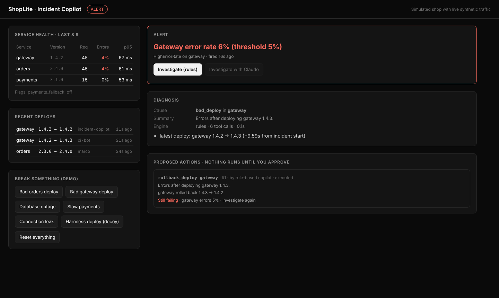
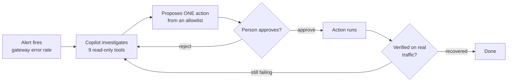

# Incident Copilot

An on-call assistant for a small online shop. When an alert fires, it investigates logs, metrics, deploy history and dependencies, names the likely cause, and **proposes** one recovery action. **A person approves it.** Then the copilot checks whether the service actually recovered.

The shop (**ShopLite**) is simulated, but the failures aren't faked. Each one is a real broken code path or a real outage in a running service, with real errors in real logs.



*Above: the rule-based copilot rolled back a harmless deploy instead of the bad one. Verification caught it ("Still failing"), so nobody walks away thinking it's fixed.*

---

## The problem

When something breaks at 3am, on-call engineers spend most of the time *finding* the cause:
- **Which service is actually failing,** behind the one customers see?
- **Which change caused it?** Deploys often land close together.
- **Is it a dependency** (the database, a payment provider)?
- **Has it already recovered on its own?**

Then they need to apply the right fix safely, and confirm it worked.

## What it does



| Layer | What's there |
|---|---|
| **ShopLite** (`shoplite/`) | 3 services as separate processes (gateway → orders → database, orders → payments provider), structured JSON logs, a deploy history, feature flags, synthetic customer traffic, an alert rule |
| **5 injectable incidents** | Bad orders deploy (crashes on coupon checkouts), bad gateway deploy (crashes on pre-release app versions), database outage, slow payment provider, connection-pool leak. Plus a **false alarm** that recovers on its own. Decoy deploys land nearby to tempt the wrong rollback. |
| **Copilot tools** (`copilot/tools.py`) | `get_alert`, `get_service_health`, `query_metrics`, `search_logs`, `get_deploy_history`, `check_dependencies`, `list_runbooks`, `get_runbook`, and one write tool: `propose_action` |
| **Safety** (`copilot/actions.py`) | Allowlisted actions only (rollback, restart, database failover, feature flag, no action). The copilot can **propose**; only a person can **approve**. Every step is logged. Recovery is verified on at least 40 real requests. |
| **Two diagnosers** | A **rule-based** copilot (free, instant: the baseline) and an **AI copilot** (Claude, through the same tools) |
| **Three ways in** | A web console (approve fixes here), an MCP server for Claude Desktop (no API key), and the eval |

## Results

`python -m eval.run_eval`: 24 incidents (6 scenarios × 4 variants, 18 of them with a decoy deploy nearby). Each one runs end to end: inject the fault, investigate, approve the proposal, send real traffic, verify.

| Metric | Rule-based copilot | AI copilot |
|---|---|---|
| Correct cause and component | 20/24 | not measured yet |
| Recovered after one approved action | 20/24 | not measured yet |
| Right action with a decoy deploy nearby | 14/18 | not measured yet |
| Wrong fixes caught by verification | **4 of 4** | |
| Verification said "recovered" while the fault was still active | **0** | |
| Actions executed without approval | **0** | |

**How to read this:**
- **The rule-based copilot's 4 misses are all the same weakness:** it rolls back the *most recent* deploy, so a harmless deploy landing after the bad one fools it. Verification caught all 4.
- **The AI copilot's numbers need an Anthropic API key.** Run `python -m eval.run_eval --diagnoser ai`. The question the eval answers: does it beat 20/24, especially on decoys?
- **The harness is checked:** `--diagnoser oracle` (which knows the true answer) scores 24/24. That proves each scenario's correct fix really recovers the system, and that the grading works.
- **Simulated workload:** synthetic traffic, time compressed 10× in the eval, SQLite with a simulated outage. The failures and fixes run through real code, but this isn't a production system.

## Run it locally

**You need:** Python 3.10+.

```bash
python3 -m venv .venv
source .venv/bin/activate         # Windows: .venv\Scripts\Activate.ps1
pip install -r requirements.txt
pytest -q                         # 19 tests, about 30 s (starts the services itself)
python -m eval.run_eval           # the results above, about 30 s
```

**The console:**
```bash
python -m console.app
```
Open **http://localhost:9200**. Then:
1. Click **Database outage**. Within a few seconds the alert fires.
2. Click **Investigate (rules)**. Read the diagnosis and the proposed action.
3. Click **Approve and run** and watch it turn **Recovered**.
4. Click **Reset everything**, then **Bad orders deploy** followed by **Harmless deploy (decoy)**. Investigate and approve again: this time the rules pick the wrong deploy, and verification shows **Still failing**.

**With Claude Desktop (no API key):** keep the console running, then follow [docs/claude_desktop_setup.md](docs/claude_desktop_setup.md). Claude investigates and proposes; you approve in the console.

**With an API key:** `cp .env.example .env`, add your key, and restart the console. The **Investigate with Claude** button turns on, and `python -m eval.run_eval --diagnoser ai` measures it.

## Project structure

```
shoplite/          the simulated shop: services.py, state.py (versions, flags, faults, deploys),
                   telemetry.py (JSON logs), traffic.py, monitor.py (alert rule), chaos.py (scenarios)
copilot/           tools.py, observability.py (log/metric queries), actions.py (allowlist, approval,
                   verification), baseline.py (rule-based), agent.py (Claude)
runbooks/          the team's runbooks, which the copilot reads
console/           web console (FastAPI + one HTML page)
mcp_server/        MCP server for Claude Desktop
eval/              the incident eval and its results
docs/              Claude Desktop setup, code tour
```

## Limitations

- **Simulated shop and traffic.** Real incidents have more signals (traces, multiple regions, partial outages) and messier logs.
- **The database outage is simulated.** The service's database layer refuses connections; there's no real Postgres here yet.
- **Time is compressed 10× in the eval.** Investigation and recovery times aren't real-world numbers.
- **Approval in the eval is simulated:** a stand-in person approves whatever is proposed, so the eval measures the copilot, not human judgement.
- **One action per incident.** The eval doesn't let the copilot try again after a failed fix.

## What's next (v2 and v3)

1. Run the AI copilot eval and compare it with the baseline.
2. Docker Compose with real Postgres, so the outage is real.
3. OpenTelemetry traces, so the copilot can follow a single request across services.
4. A React incident view and CI that runs the eval on every push.
5. Deploy to one cloud provider with infrastructure-as-code.
